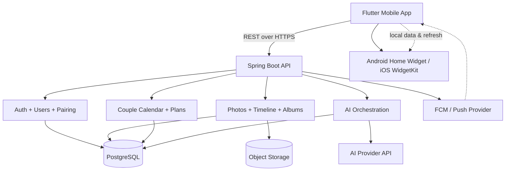
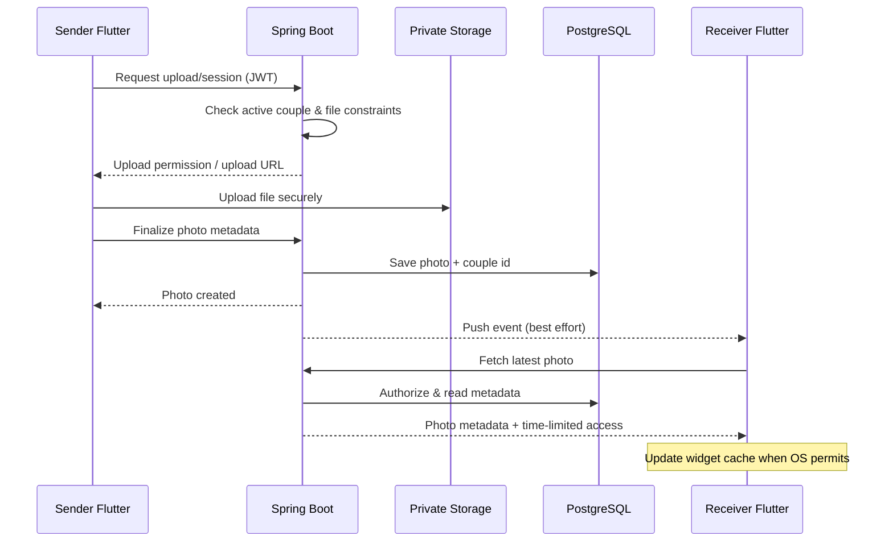

# 03. Kiến trúc hệ thống

## 3.1 Lựa chọn kiến trúc

**Modular monolith:** một Spring Boot backend tổ chức theo các domain module; một PostgreSQL; Flutter là mobile client. Docker Compose dùng cho môi trường local; AI và push notification qua external providers. Chưa làm microservices.

**Quan trọng:** Push không đồng nghĩa widget cập nhật tức thì. Widget trên từng OS cần implementation native và sẽ bị giới hạn tần suất/cơ chế refresh.

## 3.2 Technology stack dự kiến

| Layer | Công nghệ | Mục đích |
|---|---|---|
| Client | Flutter / Dart | Mobile app cross-platform |
| Widget | Android native widget; iOS WidgetKit via bridge | Ảnh màn hình chính |
| API | Java + Spring Boot | Auth, business logic, AI orchestration |
| Security | Spring Security + JWT | Authentication/authorization |
| Database | PostgreSQL + Spring Data JPA | Dữ liệu nghiệp vụ |
| Migration | Flyway | Đồng bộ schema |
| Storage | S3-compatible hoặc Cloudinary (cần chốt) | File ảnh riêng tư |
| Push | Firebase Cloud Messaging | Notification |
| AI | Hosted LLM API | Memory Story, Date Planner |
| Local env | Docker Compose | Backend, DB, optional local storage |
| CI | GitHub Actions | Build, tests, checks |

**Không khóa version bằng tài liệu này:** chốt JDK/Gradle/Maven, Flutter SDK, PostgreSQL image tag tại kickoff, đưa vào build/config để 5 máy giống nhau.

## 3.3 Domain boundaries và owners

- **identity**: auth, user, profile (shared infrastructure từ Sprint 1).
- **pairing**: invitations, couple lifecycle (shared infrastructure từ Sprint 1).
- **photo-sharing**: capture/upload/send/photo delivery/widget sync (Member 1).
- **timeline**: photo feed, filters, reaction (Member 2).
- **couple-space**: love counter, events, shared calendar (Member 3).
- **memory**: album management + AI Memory Story (Member 4).
- **date-planner**: manual plans + AI suggestions (Member 5).

Các modules dùng chung ID/DTO qua **API contract**, không gọi trực tiếp repository của module khác trừ khi có interface/service công khai được review.

## 3.4 Luồng gửi ảnh

Nếu storage không hỗ trợ signed upload URL thì API có thể nhận multipart và đẩy lên storage; nhóm chốt một cách trong ADR.

## 3.5 Luồng ghép đôi an toàn

1. Request tạo mã mời có hạn dùng; chỉ lưu **hash** mã mời nếu thiết kế cho phép.
2. Người nhận submit mã qua request body (không đặt trong URL để hạn chế lọt log).
3. Backend khóa/kiểm tra invitation, kiểm tra cả 2 user chưa có membership active.
4. Ghi couple, 2 couple_members, đổi trạng thái invitation **trong cùng transaction**.
5. DB cần ràng buộc đảm bảo mỗi user không có quá 1 membership active.

## 3.6 Quy tắc frontend/backend

- Flutter gọi API qua client lớp repository; không hardcode URL hay API key.
- Profile data không được tin vào `userId` client gửi trong request; backend lấy principal từ JWT.
- Tài nguyên dùng `couple_id` từ quan hệ user–couple do server xác minh.
- Log dùng correlation/requestId, không log secret, ảnh riêng tư, raw prompt.
- API version path `/api/v1/`; version hóa migration và thay đổi contract.
