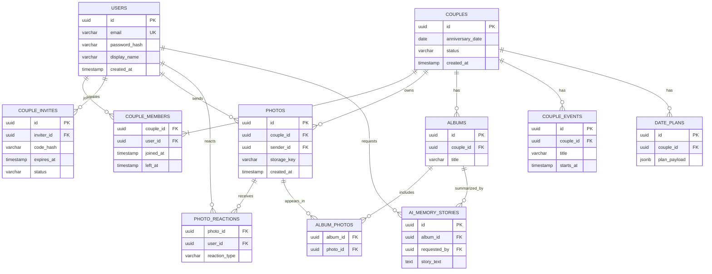

# 04. Database Design — PostgreSQL

## 4.1 Sơ đồ ERD đề xuất



## 4.2 Data dictionary trọng tâm

| Bảng | Trường chính | Ràng buộc / lưu ý |
|---|---|---|
| users | id, email, password_hash, display_name, avatar_key, created_at | email unique normalized; password hash mạnh |
| couples | id, anniversary_date, status, created_at | status active/ended |
| couple_members | couple_id, user_id, joined_at, left_at | một user chỉ 1 membership active |
| couple_invites | id, inviter_id, code_hash, expires_at, status, accepted_by | expire/single use/attempt limit |
| photos | id, couple_id, sender_id, storage_key, mime_type, size_bytes, created_at | storage private, index couple_id + created_at |
| photo_reactions | photo_id, user_id, reaction_type, created_at | unique(photo_id,user_id) nếu một reaction hiện hành |
| albums | id, couple_id, title, created_by, created_at | thuộc đúng couple |
| album_photos | album_id, photo_id, added_at | ảnh và album bắt buộc cùng couple |
| couple_events | id, couple_id, title, starts_at, reminder_at | timezone rõ ràng |
| date_plans | id, couple_id, created_by, status, plan_payload | AI output = draft trước khi xác nhận |
| ai_memory_stories | id, album_id, requested_by, story_text, input_snapshot, status | không lưu raw prompt nếu không cần thiết |

## 4.3 Data integrity và concurrency

**Quan trọng:** chỉ dùng `UNIQUE(user1_id)` và `UNIQUE(user2_id)` trên bảng couples sẽ KHÔNG đủ để cấm một user xuất hiện ở vị trí khác trong 2 couples. Đề xuất dùng `couple_members` và partial unique index:

```sql
CREATE UNIQUE INDEX uq_one_active_couple_per_user
    ON couple_members(user_id)
    WHERE left_at IS NULL;
```

- Tạo couple + 2 memberships + đổi trạng thái mã mời trong một DB transaction.
- Kiểm tra tối đa **2 thành viên**/couple bằng service transaction + constraint/trigger nếu cần; test race conditions.
- `code_hash` nên unique đối với mã đang còn hiệu lực (cần chiến lược hash/tạo mã phù hợp).
- `photos.storage_key` là path/key nội bộ, không phải public image URL.
- Mọi query tài nguyên phải lọc theo `couple_id` mà user đang có quyền truy cập.
- Xóa/hủy ghép đôi cần policy dữ liệu cụ thể trước khi viết migration.

## 4.4 Flyway migration plan

| Migration | Nội dung |
|---|---|
| V1__create_users.sql | users + unique email |
| V2__create_couples_and_members.sql | couples, couple_members, active-membership index |
| V3__create_couple_invites.sql | invitations + indexes |
| V4__create_photos.sql | photos + timeline indexes |
| V5__create_reactions_and_albums.sql | reactions, albums, album_photos |
| V6__create_events_and_plans.sql | events, date_plans |
| V7__create_ai_memory_stories.sql | AI story metadata |

Các tên Vn là minh họa, migrations sau khi merge **không sửa nội dung cũ**; tạo file migration mới nếu cần thay đổi. Với nhiều PR, tránh hai người dùng chung version.

## 4.5 Retention & audit

- Chỉ giữ metadata và object key cần thiết; ảnh ở private object storage.
- Tách môi trường local/staging; không dùng ảnh thật người dùng làm test fixtures.
- Có thể cần `deleted_at` / audit trail phù hợp chính sách sản phẩm; chưa chốt hành vi dữ liệu khi unpair.
