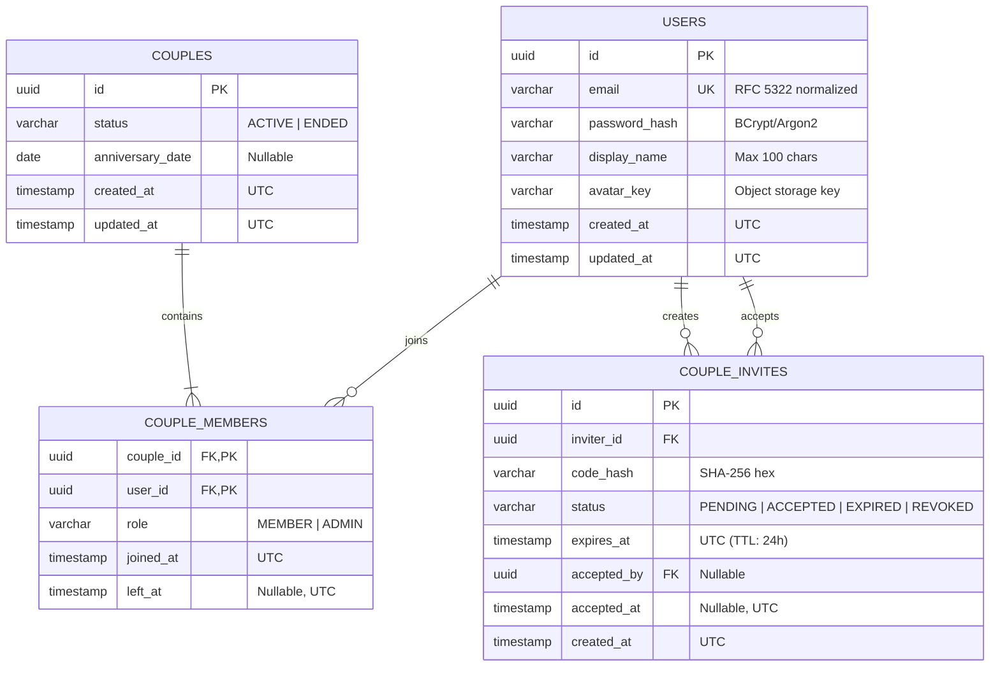

# M4 Sprint 1 — Backend DB & Pairing Technical Documentation

**Member:** 4 — Backend DB/Pairing  
**Sprint:** 1 (Foundation & Couple Connection)  
**Tasks:** S1-16, S1-17, S1-18, S1-19, S1-20  
**Feature Branch:** `feature/S1-16-20-m4-pairing`  
**Quality Status:** All 23 automated tests executed & PASSED (`mvn clean test`)

---

## 1. S1-16: Sơ đồ ERD & Flyway Migrations

### 1.1 Sơ đồ Mermaid ERD



### 1.2 Flyway Migrations (Thư mục `backend/src/main/resources/db/migration/`)

1. **`V1__create_users.sql`**: Bảng `users` phối hợp với Member 3 (Auth/Users), bảo đảm schema thống nhất, `email` unique, không trùng lặp.
2. **`V2__create_couples_and_members.sql`**: Bảng `couples` và `couple_members`.
   - **Ràng buộc cốt lõi:** PostgreSQL partial unique index ngăn chặn triệt để một người dùng có 2 couple active:
     ```sql
     CREATE UNIQUE INDEX IF NOT EXISTS uq_one_active_couple_per_user
         ON couple_members(user_id)
         WHERE left_at IS NULL;
     ```
3. **`V3__create_couple_invites.sql`**: Bảng `couple_invites` lưu hash mã mời (`code_hash`), thời gian hết hạn (`expires_at`), trạng thái single-use (`PENDING`, `ACCEPTED`, `EXPIRED`, `REVOKED`) và `accepted_by`.

---

## 2. S1-17: Thực thể, Repositories và Business Services

- **Modular Architecture:** Đặt trong package `com.ourspace.backend.pairing`.
- **Entities:** `CoupleEntity`, `CoupleMemberEntity`, `CoupleMemberId`, `CoupleInviteEntity` (và `UserEntity` tham chiếu trong `com.ourspace.backend.identity`).
- **Repositories:**
  - `CoupleRepository`: Tìm couple active thông qua `findActiveCoupleByUserId(UUID userId)`.
  - `CoupleMemberRepository`: Kiểm tra `existsByIdUserIdAndLeftAtIsNull`, truy vấn active members.
  - `CoupleInviteRepository`: Tìm và khóa dòng bằng Pessimistic Write Lock (`findFirstByCodeHashAndStatusForUpdate`).
- **Services:**
  - `InviteCodeService`: Sinh mã ngẫu nhiên 6 ký tự bảo mật cao (`SecureRandom`), bảng chữ cái tránh nhầm lẫn (`23456789ABCDEFGHJKLMNPQRSTUVWXYZ`), băm SHA-256. Không bao giờ ghi log mã thô (plaintext code).
  - `CoupleInviteService`: Xử lý tạo mã và ghép đôi trong một database transaction duy nhất (`Isolation.READ_COMMITTED`).
  - `CoupleService`: Truy vấn thông tin couple của authenticated user và quản lý unpair.

---

## 3. S1-18: REST APIs Sinh mã và Ghép đôi

### 3.1 POST `/api/v1/couple-invites`
- **Mô tả:** Tạo mã ghép đôi mới cho người dùng đã xác thực.
- **Bảo mật:** Lấy `userId` từ `SecurityContextHolder`, từ chối nếu client tự gửi ID giả mạo. Tự động thu hồi (REVOKE) các mã PENDING cũ của inviter.
- **Request:** Không body (hoặc empty `{}`).
- **Response `201 Created`:**
  ```json
  {
    "inviteCode": "K7P4R8",
    "expiresAt": "2026-10-17T13:39:01.068Z"
  }
  ```

### 3.2 POST `/api/v1/couples/join`
- **Mô tả:** Nhập mã ghép đôi để tạo liên kết couple.
- **Kiểm soát tính toàn vẹn & Transaction:**
  - Băm mã nhập vào, tìm invite với Pessimistic Lock (`FOR UPDATE`).
  - Từ chối tự ghép đôi (`CANNOT_PAIR_SELF` - 400).
  - Từ chối mã hết hạn (`INVITE_EXPIRED` - 400).
  - Từ chối mã đã dùng hoặc không tồn tại (`INVALID_INVITE_CODE` - 400).
  - Từ chối nếu joiner hoặc inviter đã thuộc về một couple active (`ALREADY_PAIRED` / `INVITER_ALREADY_PAIRED` - 409).
  - Tạo `CoupleEntity` + 2 `CoupleMemberEntity` + cập nhật `CoupleInviteEntity` sang `ACCEPTED` trong cùng 1 transaction.
- **Request Body:**
  ```json
  {
    "inviteCode": "K7P4R8"
  }
  ```
- **Response `201 Created`:**
  ```json
  {
    "id": "6cb65a74-4c84-432c-979a-4aa02a63b428",
    "status": "ACTIVE",
    "anniversaryDate": null,
    "members": [
      {
        "id": "b4468ac2-6396-44f6-857a-743fd3a64d20",
        "displayName": "Alex",
        "email": "alex@example.com",
        "role": "MEMBER",
        "joinedAt": "2026-10-16T13:39:01.429Z"
      },
      {
        "id": "95cf9b65-75a6-4786-867c-3f0ec1fff6e0",
        "displayName": "Sam",
        "email": "sam@example.com",
        "role": "MEMBER",
        "joinedAt": "2026-10-16T13:39:01.429Z"
      }
    ],
    "createdAt": "2026-10-16T13:39:01.429Z"
  }
  ```

---

## 4. S1-19: REST APIs Xem Couple & Xử lý Unpair

### 4.1 GET `/api/v1/couples/me`
- **Mô tả:** Lấy thông tin cặp đôi hiện tại của người dùng đang đăng nhập.
- **Response `200 OK`:** Trả về `CoupleResponse` như trên.
- **Response `404 Not Found`:** Nếu người dùng chưa ghép đôi:
  ```json
  {
    "code": "COUPLE_NOT_FOUND",
    "message": "Người dùng hiện không thuộc cặp đôi nào đang hoạt động.",
    "details": {},
    "requestId": "req_6d4294c9"
  }
  ```

### 4.2 DELETE `/api/v1/couples/me` (Quyết định mở OD-03)
- **Mô tả:** Endpoint hủy ghép đôi theo hợp đồng API.
- **Trạng thái:** **BLOCKED (501 Not Implemented)** theo đúng thỏa thuận tại [docs/12-open-decisions.md](12-open-decisions.md) mục OD-03: *"Khi unpair giữ/xóa album, ảnh, plans thế nào? Chưa chốt: phải được quyết định trước khi code luồng xóa"*.
- **Response `501 Not Implemented`:**
  ```json
  {
    "code": "UNPAIRING_POLICY_PENDING",
    "message": "Chức năng hủy ghép đôi đang tạm dừng chờ phê duyệt chính sách lưu trữ và xử lý dữ liệu (OD-03).",
    "details": {},
    "requestId": "req_048420f1"
  }
  ```

---

## 5. S1-20: Kiểm thử Tự động (Test Suites & Verification)

Đã cài đặt 5 test classes độc lập bao gồm **23 test cases** kiểm thử toàn diện:

1. **`InviteCodeServiceTest` (3 test cases):**
   - Độ dài 6 ký tự, đúng regex alphabet an toàn không chứa ký tự dễ nhầm.
   - Kiểm tra tính độc nhất (entropy) trên tập mẫu lớn.
   - Băm SHA-256 đồng nhất, chuẩn hóa chữ hoa/chữ thường và khoảng trắng.
2. **`CoupleInviteServiceTest` (8 test cases):**
   - Tạo mã thành công khi chưa có couple.
   - Chặn tạo mã khi đã có couple active (`ALREADY_PAIRED`).
   - Ghép đôi thành công 2 tài khoản, đổi trạng thái mã sang `ACCEPTED`.
   - Chặn tự ghép đôi (`CANNOT_PAIR_SELF`).
   - Chặn mã hết hạn (`INVITE_EXPIRED`).
   - Chặn người tham gia đã có couple (`ALREADY_PAIRED`).
   - Chặn người tạo mã đã ghép đôi với người khác trong thời gian chờ (`INVITER_ALREADY_PAIRED`).
   - Chặn mã không hợp lệ hoặc đã dùng (`INVALID_INVITE_CODE`).
3. **`CoupleServiceTest` (3 test cases):**
   - Lấy thông tin couple thành công.
   - Trả về 404 khi chưa ghép đôi.
   - Chặn unpair với mã lỗi `UNPAIRING_POLICY_PENDING` (OD-03).
4. **`PairingIntegrationTest` (7 test cases):**
   - 401 Unauthorized khi không có Bearer token.
   - E2E Flow: User A tạo mã -> User B join -> User A & B xem couple 200 -> User C xem couple 404.
   - Bắt lỗi tự ghép đôi, mã hết hạn, dùng lại mã đã chấp nhận.
   - Chặn người đã ghép đôi tham gia hoặc tạo thêm mã.
   - Kiểm tra phản hồi 501 của `DELETE /api/v1/couples/me`.
5. **`PairingConcurrencyTest` (2 multi-threaded concurrency race tests):**
   - **Race condition 1:** 2 threads đồng thời dùng chung 1 mã mời để join -> Chỉ duy nhất 1 thread thành công (201), thread kia bị từ chối/rollback, đảm bảo couple chỉ có đúng 2 thành viên.
   - **Race condition 2:** 2 threads đồng thời ghép 1 user vào 2 couple khác nhau -> Ràng buộc cơ sở dữ liệu `uq_one_active_couple_per_user` bảo đảm user không bao giờ thuộc về 2 active couples cùng lúc.

### Lệnh chạy kiểm thử:
```bash
cd backend
./mvnw.cmd clean test
```
**Kết quả thực tế:**
```text
[INFO] Results:
[INFO] Tests run: 23, Failures: 0, Errors: 0, Skipped: 0
[INFO] BUILD SUCCESS
```

---

## 6. Hướng dẫn Tích hợp với Thành viên M3 và M5

- **Member 3 (Auth/Users & JWT):**
  - Schema `users` trong `V1__create_users.sql` đã sẵn sàng.
  - Sau khi Member 3 triển khai JWT Filter, chỉ cần inject `UserPrincipal` vào `SecurityContextHolder`, toàn bộ API Pairing (`/api/v1/couple-invites`, `/api/v1/couples/**`) sẽ tự động nhận diện danh tính mà không cần sửa đổi controller.
- **Member 5 (Docker & CI):**
  - Backend xây dựng chuẩn Spring Boot 3.4 / Java 21, có file `pom.xml`, `application.yml` và script chạy `mvnw.cmd`.
  - Docker Compose chỉ cần build từ thư mục `backend/` và map biến môi trường `SPRING_DATASOURCE_URL`, `SPRING_DATASOURCE_USERNAME`, `SPRING_DATASOURCE_PASSWORD`.
