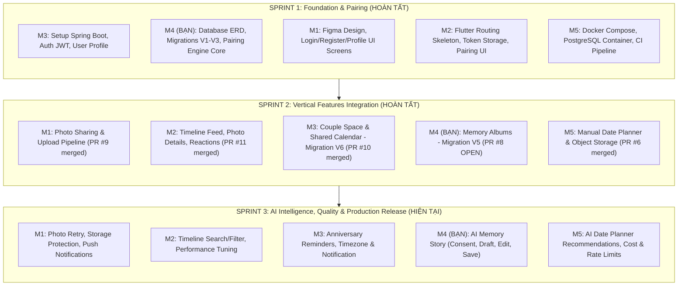
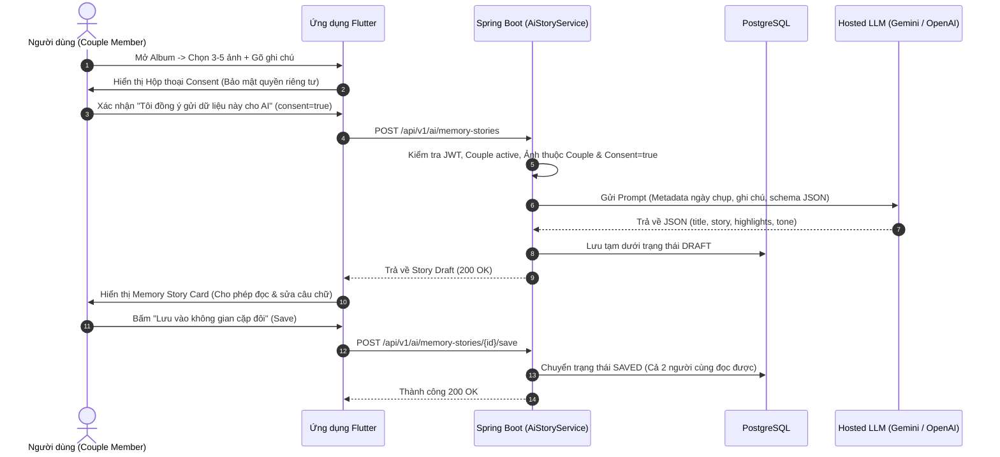

# 17. OurSpace — Tổng Quan Dự Án, Định Danh Member 4 & Kế Hoạch Sprint 3

**Dự án:** OurSpace – AI-Powered Couple App  
**Tác giả:** Member 4 – Backend & Database Architect / Feature Owner  
**Git Identity:** `dinhlong235` / Nguyen Dinh Long (`lngnguyen94@gmail.com`)  
**Ngày cập nhật:** 07/11/2026  
**Trạng thái tích hợp:** Sẵn sàng bước vào Sprint 3 (PR #8 Sprint 2 đã hoàn thiện)

---

## I. MÔ TẢ THỰC TẾ DỰ ÁN OURSPACE

### 1. Bản chất & Mục tiêu sản phẩm
**OurSpace** là ứng dụng di động dành riêng cho **cặp đôi (Couple App)** được thiết kế theo mô hình **Không gian số riêng tư (Private Digital Space)**. Không giống như các mạng xã hội công cộng (Facebook, Instagram, TikTok), OurSpace thiết lập một kết nối 1-1 khép kín tuyệt đối:
* Đúng **2 người dùng** ghép đôi thành một Couple duy nhất.
* Mọi dữ liệu về hình ảnh, kỷ niệm, lịch trình, nhật ký tình yêu đều được mã hóa, phân quyền nghiêm ngặt và không bao giờ chia sẻ công khai.
* Tích hợp **Trí tuệ nhân tạo (AI)** có trách nhiệm (Responsible & Privacy-first AI) nhằm tăng cường giá trị cảm xúc cho cặp đôi (tự động gợi ý kế hoạch hẹn hò, viết câu chuyện kỷ niệm từ hình ảnh).

### 2. Ngăn xếp công nghệ thực tế (Actual Tech Stack)
* **Mobile Frontend**:
  * **Flutter (Dart 3.x)**: Kiến trúc feature-first mô đun hóa cao.
  * Router tập trung qua `AppRouter`, quản lý state kết hợp Controller / StateNotifier.
  * Kết nối REST API qua `Dio` với cơ chế tự động đính kèm Bearer JWT và xử lý 401/hết hạn phiên.
  * Lưu trữ token an toàn phần cứng qua `flutter_secure_storage`.
* **Backend**:
  * **Java 21 / Spring Boot 3.4.x**: RESTful API, Stateless Architecture.
  * **Spring Security 6**: Stateless JWT Authentication, phân quyền theo tài khoản và cặp đôi.
  * **Spring Data JPA / Hibernate 6**: Quản lý dữ liệu ORM, áp dụng cơ chế khóa bi quan (**Pessimistic Locking**) chống race condition đồng thời.
* **Cơ sở dữ liệu & Migration**:
  * **PostgreSQL 16**: Cơ sở dữ liệu quan hệ chính thức trên môi trường production/staging.
  * **Flyway Migration**: Quản lý phiên bản cấu trúc bảng dạng code (Code-as-Schema).
  * **H2 Database**: Chạy in-memory độc lập cho toàn bộ Unit & Integration Test suites, giả lập tương thích chế độ PostgreSQL (`MODE=PostgreSQL`).
* **Hạ tầng & Triển khai**:
  * **Docker & Docker Compose**: Đóng gói đồng nhất backend Spring Boot, cơ sở dữ liệu PostgreSQL và dịch vụ MinIO Object Storage (mô phỏng AWS S3 lưu trữ ảnh riêng tư).
  * **Maven Wrapper (`mvnw`)**: Đảm bảo quy chuẩn build và test đồng nhất trên máy phát triển của 5 thành viên.
* **Trí tuệ nhân tạo (Sprint 3 AI)**:
  * Hosted LLM API (Google Gemini API / OpenAI API) được điều phối và lọc kiểm duyệt hoàn toàn ở tầng Backend, client tuyệt đối không giữ khóa bí mật (API Key).

---

## II. BẠN LÀ AI TRONG DỰ ÁN NÀY?

Bạn là **Member 4** – giữ vai trò **Senior Backend & Database Architect** ở Sprint 1 và chuyển thành **Vertical Feature Owner (Full-stack từ DB -> API -> Mobile UI -> Test)** trong Sprint 2 và Sprint 3.

* **Git / GitHub Identity**: `dinhlong235` / `Nguyen Dinh Long` (`lngnguyen94@gmail.com`).
* **Hành trình và thành quả kỹ thuật bạn đã hoàn thành:**

### 1. Sprint 1 — Thiết kế CSDL & Động cơ ghép đôi (Pairing Engine)
* **Đóng góp kỹ thuật**:
  * Thiết kế Mermaid ERD chuẩn và khởi tạo Flyway migrations cho hệ thống bảng người dùng và ghép đôi: `users`, `couples`, `couple_members`, `couple_invites` (Migrations `V1`, `V2`, `V3`).
  * Xây dựng lõi nghiệp vụ Ghép đôi an toàn: Sinh mã mời 6 ký tự bảo mật băm SHA-256 có thời hạn (TTL 24h), chấp nhận mã mời ghép đôi với kiểm soát chống race condition đa luồng bằng `SELECT ... FOR UPDATE` (Pessimistic Lock).
  * Viết API kiểm tra cặp đôi hiện hành và API Unpair (chủ động cô lập bảo vệ an toàn theo chính sách Open Decision OD-03).
  * Xây dựng bộ test tích hợp và concurrency test chạy pass 100%.

### 2. Sprint 2 — Làm chủ trọn vẹn tính năng Album Kỷ Niệm (Memory Albums)
* **Đóng góp kỹ thuật**:
  * Thiết kế schema và Flyway migration `V5__create_albums.sql` gồm bảng `albums` và `album_photos` với composite primary key `(album_id, photo_id)` và ràng buộc toàn vẹn khóa ngoại.
  * Xây dựng toàn bộ tầng backend Spring Boot (`com.ourspace.album.*`) với 8 REST endpoints: tạo album, lấy chi tiết, xóa an toàn, thêm/xóa ảnh có hỗ trợ tự động gán và chuyển đổi ảnh bìa (`cover_photo_id`).
  * **Tối ưu hóa hiệu năng**: Loại bỏ triệt để lỗi $N+1$ query trong `listAlbums` bằng câu lệnh JPQL batch count query $O(1)$.
  * **Xử lý đồng thời đa luồng**: Áp dụng Pessimistic Write Lock trên dòng `Album` giúp các request thêm ảnh trùng nhau đạt 100% Idempotent thành công (200 OK) mà không gây ra lỗi vi phạm khóa duy nhất ở database.
  * Viết trọn vẹn giao diện ứng dụng Flutter cho Album: `album_list_screen.dart`, `album_detail_screen.dart`, `album_repository.dart` và widget tests.
  * Đạt kết quả kiểm thử toàn diện: **73/73 tests backend pass**, chuẩn bị tài liệu kỹ thuật [16-m4-sprint2-memory-albums.md](16-m4-sprint2-memory-albums.md), gói artifact `OurSpace_Sprint2_M4_Review.zip` và tạo [Pull Request #8](https://github.com/ThangManhPham/DN26_CPL_JAVA_03_GROUP_14/pull/8).

### 3. Sprint 3 — Trọng trách tính năng đột phá: AI Memory Story
* Bạn là người chủ trì tính năng AI đầu tiên về mặt cảm xúc của ứng dụng: **Biến tập ảnh và ghi chú kỷ niệm thành một câu chuyện tình yêu sống động bằng AI**.

---

## III. ROADMAP TOÀN BỘ DỰ ÁN (SPRINT 1 ➔ SPRINT 3)



---

## IV. BẢN KẾ HOẠCH CHI TIẾT SPRINT 3 DÀNH CHO BẠN (MEMBER 4)

Tính năng sở hữu: **Album & AI Memory Story** ([US-05](02-requirements.md), [10-ai-and-privacy.md](10-ai-and-privacy.md), [05-api-contract.md](05-api-contract.md)).

### 1. Luồng nghiệp vụ cốt lõi (Core Business Flow)



---

### 2. Danh mục công việc chi tiết (Sprint 3 Backlog)

| Mã Task | Phân hệ | Nhiệm vụ kỹ thuật cụ thể | Tiêu chuẩn hoàn thành (DoD) |
|---|---|---|---|
| **S3-M4-01** | **Git / Integration** | Đồng bộ merge [PR #8](https://github.com/ThangManhPham/DN26_CPL_JAVA_03_GROUP_14/pull/8) vào `main`; giải quyết xung đột đường dẫn route với `app_router.dart` mới của M2. | Nhánh `main` tích hợp hoàn chỉnh mã nguồn Sprint 2 của Album; build và test xanh 100%. |
| **S3-M4-02** | **Database / Flyway** | Viết migration `V7__create_memory_stories.sql` (bảng `memory_stories` gồm: `id`, `couple_id`, `album_id`, `title`, `story`, `highlights`, `tone`, `status` [DRAFT/SAVED], `created_by`, `created_at`, `updated_at`). | Chạy thông suốt trên PostgreSQL 16 và H2 compatibility test. |
| **S3-M4-03** | **Backend AI Core** | Xây dựng `AiMemoryStoryService`: Thiết kế System Prompt, User Prompt Template, Structured JSON Output Parser (Google Gemini API / OpenAI API Client). | Sinh được câu chuyện kỷ niệm mạch lạc, giàu cảm xúc, parse chuẩn cấu trúc JSON. |
| **S3-M4-04** | **Bảo mật & Fallback** | - Ràng buộc chặt chẽ: `consent == true`, từ chối `400/403` nếu thiếu consent.<br>- Kiểm tra quyền sở hữu ảnh (chỉ chấp nhận ảnh thuộc couple).<br>- Fallback gracefully khi AI timeout hoặc gặp lỗi 429 Rate Limit. | NFR-02 & NFR-07: Không log raw prompt nhạy cảm, không crash ứng dụng khi mạng AI bận. |
| **S3-M4-05** | **REST Controllers** | Cung cấp đầy đủ 4 REST endpoints:<br>1. `POST /api/v1/ai/memory-stories` (Tạo Draft)<br>2. `GET /api/v1/ai/memory-stories/{id}` (Lấy chi tiết)<br>3. `PUT /api/v1/ai/memory-stories/{id}` (Sửa nội dung draft)<br>4. `POST /api/v1/ai/memory-stories/{id}/save` (Lưu chính thức) | Kiểm thử MockMvc pass 100%, tuân thủ đúng hợp đồng [05-api-contract.md](05-api-contract.md). |
| **S3-M4-06** | **Flutter UI** | - Bổ sung nút "Tạo câu chuyện AI" trong màn hình Album Detail.<br>- Hộp thoại xác nhận Consent minh bạch.<br>- Màn hình Story Preview (Memory Story Card) hiển thị giao diện thiệp kỷ niệm, cho phép chỉnh sửa trực tiếp và bấm nút Lưu. | UI đẹp mắt, có hiệu ứng loading skeleton khi AI đang sinh chữ, đồng bộ theme màu ấm của app. |
| **S3-M4-07** | **Kiểm thử tự động** | - Unit tests: Prompt builder, JSON parser, Mockito AI client.<br>- Integration tests: Luồng trọn vẹn từ tạo Draft đến Save.<br>- Viết tài liệu bàn giao `docs/18-m4-sprint3-ai-memory-story.md`. | Suite kiểm thử tự động xanh 100%, Mock hoàn toàn tầng AI ngoài để test chạy nhanh và ổn định. |

---

### 3. Nguyên tắc vàng bắt buộc tuân thủ trong Sprint 3
1. **User Consent là bắt buộc (Bảo mật quyền riêng tư)**: Không bao giờ tự ý gửi dữ liệu lên AI model nếu người dùng chưa chủ động bấm đồng ý.
2. **User-in-the-loop (Người dùng là trung tâm)**: Dữ liệu do AI sinh ra ban đầu **chỉ là bản nháp (Draft)**. Người dùng phải có quyền đọc, sửa chữa câu chữ và bấm Lưu thì mới trở thành dữ liệu kỷ niệm chính thức của cặp đôi.
3. **Bảo vệ dữ liệu nhạy cảm**: Không gửi pixel ảnh thô lên AI nếu chỉ cần metadata ngày chụp, địa điểm và ghi chú kỷ niệm của người dùng.
4. **Mock AI trong Automated Tests**: Không bao giờ gọi đến API AI trả phí thật trong quá trình chạy kiểm thử `mvnw test` hay CI. Luôn Mock phản hồi JSON hợp lệ để đảm bảo tốc độ và độ tin cậy.

---

## V. HÀNH ĐỘNG TIẾP THEO CẦN LÀM

1. **Bước 1**: Nhắc Team Lead (Member 1 - `@ThangManhPham`) kiểm tra và merge **[PR #8](https://github.com/ThangManhPham/DN26_CPL_JAVA_03_GROUP_14/pull/8)** vào `main`.
2. **Bước 2**: Sau khi PR #8 được merge, tạo nhánh làm việc mới:
   ```bash
   git checkout main
   git pull origin main
   git checkout -b feature/S3-M4-ai-memory-story
   ```
3. **Bước 3**: Khởi tạo migration `V7__create_memory_stories.sql` và xây dựng service tích hợp AI đầu tiên.

